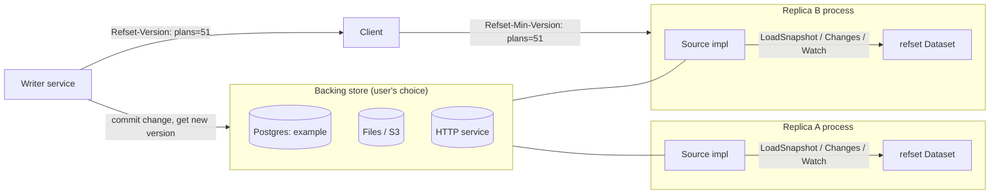

# refset: Versioned, Replicated Reference Data for Go

Design document: goals, architecture, API, guarantees and test plan. What users can rely on is summarized in [guarantees.md](guarantees.md).

Module: `github.com/azbyluthfan/refset` · License: Apache-2.0 · Minimum Go: 1.26

## 1. Goal

A Go library that keeps a whole reference dataset (permissions, plans, prices, feature flags, geofences) in the memory of every replica, kept coherent with its source of truth, with **dataset-level versions** that let a request demand "at least version N."

Reads are always local and lock-free. The network is used only in the background, by the user's `Source`, to receive changes.

**refset is an in-process, in-memory library and nothing else.** It knows nothing about databases, caches, brokers or network protocols. The library module uses only the Go standard library and has zero `require` lines in `go.mod`, test dependencies included. Storage lives behind the `Source` interface the user implements; a Postgres implementation ships as an example, not as part of the library.

### What it solves that existing libraries don't

| Library | Local reads | Coherent across replicas | Knows its exact version | Request can demand freshness | Fails closed when cut off |
|---|---|---|---|---|---|
| golang-lru, otter | Yes | No (TTL only) | No | No | No |
| rueidis client-side caching | Yes | Per key, Redis only, asynchronous | No | No | No |
| refset | Yes | Whole dataset, any source that meets the Source contract | Yes | Yes (`GetAtLeast`, `GetCtx`) | Yes (`GetFresh`) |

### Non-goals (v1)

- **Not a general cache:** no eviction, no cache-on-miss. The whole dataset must fit in memory.
- **Not for frequently written data.** Reference data is read on most requests, changed by humans or admin tools, and gives the same answer for every user. Carts, stock counts, seat holds and reservations don't fit: they are written constantly, are often per-user, and need an atomic compare-and-set at the source that no replica can give (see §4.9).
- **No transactions across datasets:** each dataset has its own version sequence, and replicas apply datasets independently.
- **No persistence by default:** a restarted process reloads from its source (§4.4), unless the source is wrapped in an opt-in `SnapshotFile`, which starts from a copy on local disk and catches up.
- **No infrastructure in the library:** the core is source-agnostic. Postgres is provided as an example source only (§6.3).

## 2. Core Concepts

- **Dataset**: a typed, in-memory replica of one reference table, `Dataset[K, V]`.
- **Source**: the user-supplied interface that loads a full snapshot and returns changes. It owns the dataset's name. Its obligations are the Source contract (§4.2).
- **Version**: a monotonically increasing integer per dataset, assigned by the source. Every committed change has exactly one version. A replica at version N has applied every change up to and including N, and nothing after.
- **Snapshot**: an immutable view of the dataset at one version. Readers always see one consistent snapshot.
- **Delta**: one committed change (upsert or delete of one or more keys) tagged with its version.
- **Head version**: the latest version the source has reported, even if not yet applied.
- **Staleness**: time since the replica last confirmed with its source that it was caught up, measured on the replica's own clocks (§4.6). Not the age of the data.
- **Lag**: `head - applied`, in versions.

## 3. Architecture



Everything inside a replica process except the `Source` implementation is refset. The `Source` implementation is user code (or a copied example) and is the only part that talks to infrastructure.

## 4. Design

### 4.1 Storage and reads

- The snapshot is split into shards, each an immutable Go map. By default the count is about 2.5 × √entries rounded up to a power of two (256 at 10k entries, 4096 at 1M), chosen at `Open` and again on a full reload when the size has moved a lot; `Options.Shards` fixes it. Each version carries its own shard count, so a reload can change it while readers of older versions keep theirs.
- The root (shard array plus version) sits behind an `atomic.Pointer`. A read loads the root, picks the shard by `maphash.Comparable` of the key, and looks up the map. No locks.
- Applying a batch copies only the shards it touches, builds a new root, and swaps it atomically. Readers see the whole batch or none of it.
- Changes arriving close together are applied as one batch to limit copying: a notification after a quiet period polls at once, and notifications within `BatchWindow` (default 5 ms) of the last poll wait for the rest of the window. A read waiting for a version polls at once regardless.

### 4.2 The Source contract

The library's boundary with the outside world. Specified in `docs/source-contract.md` and checked by `refsettest.RunConformance(t, factory)`, which any source (in-memory, Postgres example, file example, third-party) can run.

The simplest compliant source is `refset.ReloadSource`, built from two of the application's own functions: `Load` (every value plus the version it reflects) and `Version` (the current version, cheaply). Its `Changes` never returns per-key changes; when the version moves it returns `ErrSnapshotRequired` and the dataset reloads everything. That suits most reference data and needs no changelog, tables or adapter. The `structs`, `dbrows` and `httpjson` examples use it.

```go
type Source[K comparable, V any] interface {
    Name() string
    LoadSnapshot(ctx context.Context, add func(key K, value V)) (version uint64, err error)
    Changes(ctx context.Context, after uint64) (head uint64, deltas []Delta[K, V], err error)
    Watch(ctx context.Context) (<-chan uint64, error)
}

// Optional. Implemented by sources that can answer a single key directly.
type KeyLoader[K comparable, V any] interface {
    LoadKey(ctx context.Context, key K) (V, bool, error)
}
```

| # | Requirement | Supports |
|---|---|---|
| C1 | `LoadSnapshot` streams entries (through its `add` callback, so a mid-stream error can be reported) that are exactly the state at `version` | G1 |
| C2 | Versions are totally ordered and gap-free: every committed change has one version, and versions become visible only in commit order | G1, G3 |
| C3 | A nil-error `Changes(after)` returns every change in `(after, head]`, `head` is the source's latest version as of the call, and values reflect exactly the state at `head` | G1, G3, G5 |
| C4 | If changes after `after` cannot be expressed as per-key changes (compacted away, too many, or the source recorded a whole-dataset change), `Changes` returns `ErrSnapshotRequired` | G3 |
| C5 | `Watch` is best effort: it may drop, duplicate or delay notifications; correctness never depends on it | G3 |
| C6 | `KeyLoader.LoadKey`, if implemented, returns the source's current value, at a version ≥ any version it has reported | G4 |
| C7 | `Name` is stable for the life of the source and matches the name writers use in version headers | G4 |

Why the source owns the name: `GetCtx` must pick its dataset's entry out of a request's version map (`{"plans": 51, "perms": 9}`). A second copy of the name in `Options` could silently disagree, and then `GetCtx` would skip the wait and read-your-writes would quietly break. Docs recommend declaring each name once as a constant shared by the source and the writer.

### 4.3 Update loop

- After `Open`, a background goroutine (the loop) runs `Changes(applied)` whenever `Watch` fires, on a poll ticker (default 1 s), and when a read asks it to poll now (§4.5). A missed notification only delays a change, never loses it.
- **The loop is the only caller of `Changes` and the only writer of snapshots.** Reads never call the source's change feed themselves, so application stays single-threaded and a read can never race the loop applying the same range.
- **Poll-now requests are coalesced.** At most one `Changes` call is in flight, plus at most one queued follow-up. Every poll has a sequence number and records when it started. Any number of poll-now requests arriving while a poll is in flight share the single follow-up. So N concurrent requests cause at most two source calls, not N.
- Each successful `Changes` result is applied as one batch ending at `head`. The applied version can jump by more than one, but every applied version is one the source actually committed; it never skips a change and never goes backwards. G1 holds for every version a replica exposes.
- Deltas with `version ≤ applied` are ignored (duplicate delivery is harmless).
- On `ErrSnapshotRequired`, the replica reloads a full snapshot in the background. The old snapshot keeps serving reads until the new one swaps in. Shard maps are created at their expected size. When values can be compared (`==` for comparable types without interfaces, or `ReloadSource.Equal`), a shard whose entries all came back unchanged is kept from the old version instead of rebuilt, so a reload that changes little allocates little; otherwise memory briefly holds two copies.
- On other errors, the loop retries with backoff; reads continue from memory and staleness grows (§4.6).

### 4.4 Startup and restarts

The dataset lives only in process memory, so every process start (first deploy, crash, restart, scale-out) begins empty.

- `Open` calls `LoadSnapshot` and blocks until the full dataset is in memory. Reads are never served from a partial or empty dataset.
- If the source is unavailable, `Open` returns an error when `ctx` expires. There is no silent start with empty data.
- After `Open`, the replica catches up through `Changes` like any other replica. Nothing from before the restart is needed.
- Operational consequences, documented for users:
  - Startup time grows with dataset size (published in `docs/benchmarks.md`).
  - Report ready (e.g. a Kubernetes readiness probe) only after `Open` returns.
  - Restarting many replicas at once means many full loads hitting the source together; roll restarts gradually.
- Starting from a snapshot saved on local disk: `SnapshotFile` (opt-in) wraps a source. `Open` loads the file into a separate version, falling back to the source if the checksum, dataset name, key and value type fingerprint or `MaxAge` doesn't match, then polls `Changes(fileVersion)` at once. Its last-confirmed time starts at "never", so `GetFresh` fails closed until the first successful catch-up. If the source compacted past the file or its history is behind it, the dataset reloads. Entries are encoded with `encoding/gob`; `Save` refuses types with unexported fields, which gob would drop, and writes atomically (temporary file, fsync, rename) with mode 0600.

### 4.5 Version-aware reads

- `Get(key)`: instant, from the current snapshot. Never waits, never errors.
- `GetAtLeast(ctx, key, minVersion)`:
  - If `applied ≥ minVersion`, answers instantly (lock-free).
  - Otherwise it registers a waiter. If `minVersion` is above the known head, which is the **normal** read-your-writes case (the replica usually hasn't heard of version 51 yet because the notification hasn't arrived), it also asks the loop to poll now (§4.3) and never calls the source itself.
  - It waits until one of these happens, or the wait bound passes (default 50 ms, or the context deadline if sooner):
    - The version is applied → answer from the snapshot.
    - **A poll that started after this request arrived** completes and the head is still below `minVersion` → `ErrVersionAhead`, with no fallback. Requiring a poll that started after the request matters: the writer committed before the client sent the request, so only such a poll is guaranteed to see the write.
  - On timeout: if the source implements `KeyLoader`, calls it; otherwise returns `ErrNotCaughtUp`. If `ctx` ends first, returns `ctx.Err()` without a fallback.
  - **Cost of inflated headers:** a forged `plans=999999999` or `plans=<head+1>` costs at most a share in one coalesced poll, never a dedicated source call or a fallback query. The source sees at most about one extra `Changes` call per poll duration, however many such requests arrive. For public-facing clients, enable header signing (§4.7) so forged versions are ignored before they reach the dataset.
- `GetCtx(ctx, key)`: reads the minimum version for `src.Name()` from the context (set by `ContextWithMinVersion`, usually via `refsethttp.Middleware`) and behaves like `GetAtLeast`. With no version in the context, behaves like `Get`.
- Waiters are kept in a min-heap by version and released when a batch is applied.
- **Fallback calls are collapsed per key:** concurrent `KeyLoader` calls for the same key share one call (in-house singleflight, stdlib only). `Options.MaxConcurrentFallbacks` optionally caps calls in flight; over the cap, the request gets `ErrNotCaughtUp`.
- Fallback answers are returned to the caller but never written into the snapshot and never advance the applied version.

### 4.6 Staleness policy

The question a replica can answer, even when cut off, is "how long since I last confirmed I'm not missing anything?". The original definition ("age of the oldest unapplied change") cannot be measured by a cut-off replica, which never learns that changes exist, so it would report zero lag and never fail closed.

- `lastConfirmed` = start time of the last successful `Changes` call after which `applied == head`, or of the last successful `LoadSnapshot` (whose version is the head at some moment during the call, contract C1). `Watch` notifications never confirm freshness; they only wake the loop and raise the known head.
- Staleness = `max(monotonic elapsed, wall-clock elapsed)` since `lastConfirmed`, with negative wall elapsed counted as 0. Only the replica's own clocks are used, never a timestamp from the source, so clock skew between machines never matters. Taking the larger of the two makes every clock error push toward failing closed:

  | Event | Monotonic | Wall | Result |
  |---|---|---|---|
  | Normal operation | correct | about the same | correct |
  | System/VM suspend and resume | stops counting (Linux, macOS) | jumps forward | stale → fail closed |
  | Wall clock stepped backwards | correct | negative → 0 | monotonic wins |
  | Wall clock stepped forwards | correct | jumps forward | spurious `ErrTooStale` for up to one poll interval (safe direction) |
  | GC pause, CPU throttling, container freeze | keeps counting | keeps counting | stale → fail closed |

- `lastConfirmed` is stored as two raw readings (monotonic ns, wall ns), not as a `time.Time`, because Go silently drops the monotonic reading on `Round(0)`, `Truncate` and serialisation.
- Per dataset: `MaxStaleness` (time) and `MaxLagVersions`.
- `GetFresh(key)`: returns `ErrTooStale` if staleness exceeds `MaxStaleness` or lag exceeds `MaxLagVersions`. Used for fail-closed decisions such as revocation. `Get` and `GetAtLeast` never return `ErrTooStale`.
- `Open` rejects `MaxStaleness <= PollInterval` (a healthy replica would fail between polls). Recommended: at least 2× `PollInterval`.
- **The guarantee in one line:** a change committed at time *t* is refused by `GetFresh` on every replica by *t* + `MaxStaleness`, up to the replica clock's rate error (negligible).
- `Stats()`: applied version, head version, lag in versions, staleness, last apply time, reload count, shard count and copy-on-write counters (batches applied, shards and entries copied, shards kept by reloads), and, once the reconcile check exists, divergence count.
- `GetFresh` bounds how far behind the source's change feed a replica is. It cannot detect changes the feed never recorded (§4.10).

### 4.7 Version propagation

- Writers get the new version from their own store (the Postgres example's `Write` returns it) and send it to the client, e.g. response header `Refset-Version: plans=51`.
- Clients send it back as `Refset-Min-Version: plans=51`, or the app stores it in a session cookie.
- The core holds the transport-neutral hook: `refset.ContextWithMinVersion(ctx, dataset, v)` and `refset.MinVersion(ctx, dataset)`.
- `refsethttp` is an optional package in the library module (only `net/http`; core-only users don't import it and pay nothing):
  - `SetVersion(w, dataset, v)` and `SetVersions(w, map[string]uint64)` merge into one header, sorted and keeping the highest version per dataset (`perms=9,plans=51`). Dataset names are 1–64 letters, digits, `.`, `_` or `-`; an invalid name panics, since it is a programming error (declare names as constants shared with the source).
  - `Middleware(next)` parses the header (and cookies, if enabled) into the request context with `ContextWithMinVersion`. `Handler.MinVersions(r)` returns the same data plus an error describing anything ignored, for logging.
  - Package-level functions use the default configuration; `refsethttp.New(Config)` returns a `Handler` with the same methods for custom settings.
  - `Config` (zero value valid): `VersionHeader` / `MinVersionHeader` (defaults `Refset-Version` / `Refset-Min-Version`); `CookiePrefix` enables cookies; `CookieMaxAge` (default 10 minutes); `CookieInsecure` for local HTTP; `SigningKey` and `VerifyKeys`.
  - **Cookies** are per dataset, named `CookiePrefix + dataset` (e.g. `refset_plans`), so a write to one dataset never overwrites another's version. They are `HttpOnly`, `Secure` (unless `CookieInsecure`), `SameSite=Lax`, `Path=/`. Browsers then carry versions with no client code. The higher of header and cookie wins.
  - **Signing:** with `SigningKey` (at least 16 bytes), each value is written as `51~<signature>`, where the signature is HMAC-SHA256 truncated to 128 bits over the dataset name and version, so it can't be moved to another dataset or number. The middleware then ignores unsigned or badly signed values. `VerifyKeys` lists older keys still accepted during rotation. A signature is not tied to a user: replaying a genuine version is harmless, because it only asks for data that exists.
  - **Limits:** headers over 4 KB are ignored entirely; at most 32 entries are read; versions must be plain decimal `uint64`. Malformed entries are skipped individually. The request always proceeds; it is never rejected.
  - Browser JavaScript reading `Refset-Version` across origins needs it in `Access-Control-Expose-Headers`; `refsethttp` does not set CORS headers.
- Other transports (gRPC metadata, message headers) would be separate adapters calling `ContextWithMinVersion`; a CLI or batch job can call `GetAtLeast` directly.

### 4.8 Values are read-only

`Get` returns `V` directly. If `V` holds a map, slice or pointer, that memory is shared by every reader of the snapshot, and mutating it corrupts the dataset for everyone. refset does not clone on read (it would cost the fast reads). This is documented on `Dataset`, `Get`, `Snapshot` and in the README, with a godoc example of the safe pattern (copy before modifying). Race tests check that values are not mutated.

### 4.9 Modelling guidance

- **Does it fit?** Read on most requests, changed by humans or admin tools, same answer for every user.

  | Domain | Fits refset | Keep in the database |
  |---|---|---|
  | E-commerce | catalog, prices, tax rules, shipping zones, promo rules, currency rates | carts, stock, orders, payments |
  | Ticketing | events, venues, seat maps, price tiers, sales windows, purchase limits | seat holds, availability, reservations |
  | SaaS | plans, permissions, feature flags, rate-limit tiers | usage counters, sessions |

- **Derive instead of store.** If a Pro tier implies `reports:advanced`, keep a small `tier_perms` dataset and compute permissions at read time. An upgrade then writes one dataset, and replicas can never see the new plan with old permissions.
- **Merge datasets that always change together** into one dataset: one version, applied together.
- **Cross-dataset reads are not atomic on replicas.** Even when two datasets commit in one source transaction, a replica applies each independently, so for a few milliseconds it can see the new plan with the old permissions. To read your own write across both, send both versions (`plans=51,perms=9`); each `GetCtx` waits for its own. Requests without the header can still see the gap.
- **Keep multi-dataset writes short**: in the Postgres example, declared datasets stay locked until commit, so other writers to them wait.

### 4.10 What refset cannot detect: unlogged changes

All guarantees assume the source's change feed is complete (contract C2/C3). If the backing store changes and the feed doesn't record it, replicas silently diverge from the source until their next full reload, and **`GetFresh` still reports them as fresh**: "fresh" means "caught up with everything the source reported", not "identical to the source". Typical causes in the Postgres example:

- A writer updates rows without `Write`, or forgets `tx.LogUpsert` for some keys.
- A writer logs keys to the wrong dataset.
- A change to a joined table logs nothing (§6.3, "Datasets built from joins").
- Someone edits the table by hand or in a migration without triggers.

This is stated explicitly in `docs/guarantees.md`. Mitigations:

| Mitigation | When | What it does |
|---|---|---|
| Trigger capture (§6.3) | v0.1, Postgres example | Removes "forgot to log" for single-table datasets: every write is captured |
| `Options.ReloadInterval` | v0.1, core, off by default | Periodic full reload in the background (e.g. hourly). Bounds how long a divergence can last; doesn't detect it |
| Reconcile check | v0.3, core, opt-in (`Options.Reconcile`) | Periodic reload that also **diffs** before swapping and reports divergence (below) |

**Reconcile check (`Options.Reconcile`, needs `ReloadInterval`).** On each periodic reload the loop loads a fresh snapshot at version S while the replica is at version A. After the load it asks the source for every change since A (which covers S and anything committed during the load), then compares the two snapshots on every key *not* touched by those changes. Those keys must be equal; an added, changed or removed one means the feed missed a change. The loop counts them in `Stats().Divergences`, logs a warning with the count (not the keys, which are often user IDs), and installs the fresh snapshot. Values are compared with `==`, `ReloadSource.Equal`, or `reflect.DeepEqual` when neither applies; shards the reload kept unchanged are skipped, so the cost is small when little changed. If the changes since A are unavailable (`ErrSnapshotRequired`) or the source's history went backwards, it installs the snapshot without comparing. With `ReloadSource`, whose version doesn't move when an application forgets to bump it, this detects exactly that mistake.

### 4.11 Memory and CPU caches

refset's speed comes from reads that hit CPU caches. Software can't choose what the CPU caches: the hardware loads whole cache lines on use, keeps them per core (L1, usually L2) or shared (L3), evicts by an approximately least-recently-used policy within small address-determined sets, prefetches only predictable access, and invalidates a line in every other core's cache when one core writes to it. Code controls only layout and access patterns, so the design follows these rules:

| Hardware limit | Rule in refset |
|---|---|
| Cache lines are 64 B (x86) or 128 B (Apple Silicon); a write invalidates the whole line on other cores | **R1** The read path never writes shared memory and never allocates. **R2** Fields read by every `Get` (`root`, layout, config) sit on different cache lines from fields the loop writes each poll (counters, known head, last confirmed time) and fields waiting requests write (waiter heap), separated by 128-byte padding |
| L1 is 32–128 KB per core | **R3** The fixed read-path overhead stays small: the shard slice is `Shards` × 8 bytes (2 KB at 256 shards) |
| L2 is 1–16 MB, L3 8–100+ MB | **R4** Small datasets (around 10k entries) are served mostly from cache; at around 1M entries random keys cost a main-memory access (~100 ns). Benchmarks publish this curve |
| Maps store values inline; each pointer is another possible miss | **R5** Keep `V` compact; above roughly one cache line, consider storing `*V` |
| Copying large blocks streams through and evicts the cache | **R6** Copy-on-write copies whole shards; more shards mean smaller copies. Apply cost vs shard count is benchmarked |
| RAM is finite | **R7** A reload holds two full copies until the swap |
| Hash lookups and pointer chasing defeat prefetching and cost GC scanning | **R8** A flat, single-hash layout was measured and not adopted (P2): Go's Swiss-table maps matched or beat it on reads and memory together |

R1 and R2 are enforced in the core today (zero-allocation tests, padded `Dataset` struct, a parallel-read-while-polling benchmark). R4–R6 are measured before v0.1 and published in `docs/benchmarks.md`.

## 5. Public API (v1)

```go
// package refset

type Dataset[K comparable, V any] struct { /* ... */ }

func Open[K comparable, V any](ctx context.Context, src Source[K, V], opts Options) (*Dataset[K, V], error)

func (d *Dataset[K, V]) Get(key K) (V, bool)
func (d *Dataset[K, V]) GetAtLeast(ctx context.Context, key K, minVersion uint64) (V, bool, error)
func (d *Dataset[K, V]) GetCtx(ctx context.Context, key K) (V, bool, error)
func (d *Dataset[K, V]) GetFresh(key K) (V, bool, error)
func (d *Dataset[K, V]) Snapshot() Snapshot[K, V] // immutable; Version(), Get, Len, All() iter.Seq2[K, V]
func (d *Dataset[K, V]) Version() uint64
func (d *Dataset[K, V]) Name() string
func (d *Dataset[K, V]) Stats() Stats
func (d *Dataset[K, V]) Close() error

type Source[K comparable, V any] interface { /* §4.2 */ }
type KeyLoader[K comparable, V any] interface { /* §4.2, optional */ }

type Delta[K comparable, V any] struct {
    Version uint64
    Ops     []Op[K, V] // upsert (Key, Value) or delete (Key)
}

// Zero value of every field means "use the default". Disabling uses a sentinel.
type Options struct {
    Shards                 int           // 0 → about 2.5 × √entries, a power of two; else must be a power of two
    BatchWindow            time.Duration // 0 → 5ms; shortest time between notification-driven polls
    WaitBound              time.Duration // 0 → 50ms; -1 → never wait
    PollInterval           time.Duration // 0 → 1s
    MaxStaleness           time.Duration // 0 → unchecked; must exceed PollInterval
    MaxLagVersions         uint64        // 0 → unchecked
    MaxConcurrentFallbacks int           // 0 → unlimited
    ReloadInterval         time.Duration // 0 → never; periodic full reload to bound unlogged-change divergence (§4.10)
    Clock                  Clock         // nil → real clocks (monotonic + wall)
    Logger                 *slog.Logger  // nil → discard
}

func ContextWithMinVersion(ctx context.Context, dataset string, v uint64) context.Context
func MinVersion(ctx context.Context, dataset string) (uint64, bool)

var (
    ErrNotCaughtUp      = errors.New("refset: not caught up to requested version")
    ErrVersionAhead     = errors.New("refset: requested version is beyond the source head")
    ErrTooStale         = errors.New("refset: replica is too stale")
    ErrSnapshotRequired = errors.New("refset: changes unavailable, full snapshot required")
    ErrClosed           = errors.New("refset: dataset closed")
)
```

There are no functional options. `Options` is a plain, non-generic struct (like `slog.HandlerOptions`): every setting is in one godoc entry, adding fields is backward compatible, and `refset.Options{}` means all defaults. The fallback is the only setting that depends on `K` and `V`, so it lives on the source as the optional `KeyLoader` interface instead of making `Options` generic. Custom fallbacks wrap the source.

Packages in the library module (all stdlib only):

- `refset`: core dataset, snapshots, waiters, staleness, context helpers, and `ReloadSource` (a source built from a load function and a version function).
- `refset/refsettest`: `MemSource` with controllable delays, drops, partitions, errors and compaction; `FakeClock` (monotonic and wall readings move independently); `RunConformance`.
- `refset/refsethttp`: header and cookie helpers and middleware.

Outside the library (separate modules, any dependencies): `examples/` (including `pgsource`, `filesource`, and the `ReloadSource` examples `structs`, `dbrows`, `httpjson`) and `bench/`.

## 6. Usage Examples

The examples use `examples/pgsource`, the reference Postgres source (§6.3). Any other source works the same way.

### 6.1 Simple: currency reference table

Every request converts prices; the table changes a few times a day. No version requirements, just fast local reads that stay current.

```go
const CurrenciesDataset = "currencies"

type Currency struct {
    Code     string
    Decimals int
    RateUSD  float64
}

listener := pgsource.NewListener(pool, nil) // one per pool, shared by all sources; nil logger
src := pgsource.NewSource[string, Currency](pool, listener, pgsource.Table[string, Currency]{
    Dataset:     CurrenciesDataset,
    Query:       "SELECT code, decimals, rate_usd FROM currencies",
    ByKeysQuery: "SELECT code, decimals, rate_usd FROM currencies WHERE code = ANY($1)",
    Key:         func(c Currency) string { return c.Code },
})

currencies, err := refset.Open(ctx, src, refset.Options{})
if err != nil {
    log.Fatal(err) // source unreachable: don't start with empty data
}
defer currencies.Close()

// Hot path: local, lock-free.
if c, ok := currencies.Get("IDR"); ok {
    amount := usd * c.RateUSD
    _ = amount
}
```

### 6.2 Complex: plan upgrade with read-your-writes, plus fail-closed revocation

**Scenario.** A customer upgrades from Free to Pro. Billing writes the new plan and redirects the user. Their next API call, about 50 ms later, lands on replica B, which must not answer "Free."

**Writer side (billing service):**

```go
const PlansDataset = "plans"

func upgradePlan(w http.ResponseWriter, r *http.Request) {
    userID := currentUser(r)

    versions, err := pgsource.Write(r.Context(), pool, func(tx *pgsource.Tx) error {
        _, err := tx.Exec(r.Context(),
            "UPDATE user_plans SET plan = 'pro' WHERE user_id = $1", userID)
        if err != nil {
            return err
        }
        return tx.LogUpsert(PlansDataset, userID) // collects the key; logged at commit
    }, PlansDataset)
    if err != nil {
        http.Error(w, "upgrade failed", http.StatusInternalServerError)
        return
    }

    refsethttp.SetVersions(w, versions) // Refset-Version: plans=51
    http.Redirect(w, r, "/dashboard", http.StatusSeeOther)
}
```

**Reader side (API replica B):**

```go
plansSrc := pgsource.NewSource[string, Plan](pool, listener, pgsource.Table[string, Plan]{
    Dataset:     PlansDataset,
    Query:       "SELECT user_id, plan AS tier FROM user_plans",
    ByKeysQuery: "SELECT user_id, plan AS tier FROM user_plans WHERE user_id = ANY($1)",
    ByKeyQuery:  "SELECT user_id, plan AS tier FROM user_plans WHERE user_id = $1", // enables KeyLoader fallback
    Key:         func(p Plan) string { return p.UserID },
})

plans, err := refset.Open(ctx, plansSrc, refset.Options{WaitBound: 50 * time.Millisecond})

mux.Handle("/v1/reports/advanced", refsethttp.Middleware(http.HandlerFunc(
    func(w http.ResponseWriter, r *http.Request) {
        plan, ok, err := plans.GetCtx(r.Context(), currentUser(r))
        if err != nil || !ok {
            http.Error(w, "plan unavailable", http.StatusServiceUnavailable)
            return
        }
        if plan.Tier != "pro" {
            http.Error(w, "upgrade required", http.StatusForbidden)
            return
        }
        serveAdvancedReport(w, r)
    })))
```

What happens: the client echoes `Refset-Min-Version: plans=51`. Replica B is at version 50 and usually hasn't heard of 51 yet, so it asks its loop to poll now. The poll fetches and applies 51 within a few milliseconds, then B answers "pro." Concurrent requests share that one poll. If the change is delayed past 50 ms, the source's `KeyLoader` queries Postgres once (collapsed with any concurrent requests for the same user). A forged `plans=999999999` gets `ErrVersionAhead` after sharing one poll, with no fallback query. Requests without the header are served instantly from memory.

**Revocation, the mirror case (permissions dataset):**

```go
perms, _ := refset.Open(ctx, permsSrc, refset.Options{
    PollInterval: time.Second,
    MaxStaleness: 2 * time.Second,
})

func authorize(userID, action string) bool {
    p, ok, err := perms.GetFresh(userID)
    if errors.Is(err, refset.ErrTooStale) {
        return false // fail closed: this replica can't confirm it is current
    }
    return ok && p.Allows(action)
}
```

A revoked user doesn't send a version, so the protection here is the staleness bound: a replica that hasn't confirmed it is caught up for more than 2 seconds denies rather than trusting old data. This holds even if the replica is fully cut off from its source, and even across a VM suspend (§4.6).

### 6.3 Reference Postgres source (`examples/pgsource`)

An example in its own module, not part of the library. Written as if it were a package (exported API, godoc, tests) so it can later be promoted to an official `github.com/azbyluthfan/refset/refsetpg` module without a rewrite, once there is real demand. It passes `RunConformance` against real Postgres.

**Schema** (`schema.sql`, applied by `Migrate`):

- `refset_versions(dataset text primary key, version bigint not null, compacted_through bigint not null)`: the head, and the version up to which the changelog was deleted
- `refset_changelog(dataset text, version bigint, key text, reload boolean, committed_at timestamptz default now())`, indexed on `(dataset, version)`. A reload marker is a row with `reload = true` and an empty key.

**Write path** (`Write(ctx, pool, fn, datasets...) (Versions, error)`):

1. Begin. Lock the declared datasets' version rows in sorted order (`SELECT … FOR UPDATE`, inserting missing rows). Sorted locking means two writers can never deadlock, whatever order their SQL runs in.
2. Run `fn(tx)`. `tx.LogUpsert(dataset, keys...)` / `tx.LogDelete(dataset, keys...)` only collect keys. `tx.LogReloadAll(dataset)` records that the whole dataset may have changed (see "Datasets built from joins" below). Logging to an undeclared dataset returns an error and the transaction rolls back.
3. Before commit, for each dataset that actually logged something: bump its version, insert changelog rows (keys, or one reload marker), and `pg_notify('refset', '<dataset>:<version>')` (delivered on commit). Declared but untouched datasets keep their version, so declaring "just in case" creates no empty versions.
4. Commit and return `Versions` (a `map[string]uint64` with `Get(dataset)`).

The row lock makes commit order equal version order (contract C2). The cost is that writes to one dataset are serialized, and a multi-dataset write holds all declared locks until commit; acceptable for write-light reference data.

**Why the changelog stores only keys:** storing the value too would be a second copy of the truth that a buggy writer can get wrong (a wrong value goes unnoticed until the next reload). Values would also break on schema changes and bloat the log. Key-only re-reads the dataset's own query, so values always come from the table itself. Key-only logging does not prevent a *missing* log entry; see §4.10.

**Datasets built from joins.** Re-reading by key gives correct values for a join-derived dataset only if every change to *any* table in the join logs the dataset keys it affects. Changing one row of `tiers` can affect every user in a `user_plans ⋈ tiers` dataset, and nothing maps that row to user keys automatically. Supported ways, in order of preference:

1. **Avoid the join** (§4.9 "derive instead of store"): replicate `tiers` as its own small dataset and join at read time. Each dataset then maps to one table, and key logging is straightforward.
2. **Writer logs the affected keys:** the writer computes them inside the transaction (e.g. `SELECT user_id FROM user_plans WHERE tier = $1`) and passes them to `tx.LogUpsert`. Large key sets fall back to a reload through the backlog threshold.
3. **A key-mapping trigger maps changed rows to keys:** `InstallKeyMappingTrigger(ctx, pool, mode, dataset, joinedTable, keysSQL)` runs `keysSQL` over the joined table's changed rows (available as `refset_changed`) and logs the dataset keys it returns, so only those keys are re-read. The query is checked when the trigger is installed.
4. **Writer or trigger forces a reload:** `tx.LogReloadAll(dataset)` (or a reload-mode trigger on the joined table, below) records a marker; `Changes` returns `ErrSnapshotRequired` when a marker is in range, and replicas reload the full dataset. Right for rarely changed lookup tables.

Single-table datasets need nothing extra. Key-mapping triggers (a trigger on a joined table that runs a query to find affected dataset keys) are deferred until there is demand.

**Read path:**

- `LoadSnapshot`: one `REPEATABLE READ` transaction reads the version row and the full `Query`, so snapshot and version are consistent (C1).
- `Changes(after)`: first a cheap read of the version row only (no transaction); if `head == after`, return immediately. Otherwise one `REPEATABLE READ` transaction reads the head, the changelog keys in `(after, head]`, and the current rows for those keys via `ByKeysQuery` (a missing row means delete). All three come from one MVCC snapshot, so the result is exactly the state at `head` (C3).
- `ErrSnapshotRequired` (C4) when `after` is below the dataset's `compacted_through` watermark, when a reload marker is in range, or when the backlog's key set exceeds `Table.BacklogLimit` (default 10,000 keys).
- `Watch`: subscribes to a shared `Listener` (one `LISTEN refset` connection per pool, reconnecting with backoff), filtered to this dataset. Wake-up only (C5).
- `LoadKey` (C6): implemented when `Table.ByKeyQuery` is set.
- `Compact(ctx, pool, retention)` deletes changelog rows older than `retention` (24 h is a sensible choice) and raises each dataset's `compacted_through`; `CompactThrough(ctx, pool, dataset, version)` does it for one dataset up to a version. Run it from a cron job or one leader. Replicas never delete.

**The source must read from the primary.** `Changes`, `LoadKey` and the head check must see every committed write. A Postgres read replica lags the primary, so its head trails the writer's: a legitimate `plans=51` would look ahead (`ErrVersionAhead` instead of a short wait), and `LoadKey` could return pre-upgrade data, breaking C6. Therefore:

- The pool passed to `NewSource` must point at the primary. `NewSource` checks `SELECT pg_is_in_recovery()` on first use and returns an error if it is connected to a standby.
- Through a connection pooler or load balancer, the route must go to the primary; the check also catches misrouting after a failover on reconnect.
- Loading the full snapshot from a read replica is safe in principle (a consistent snapshot at an older version, then caught up from the primary) and could save primary load on startup, but is left for later. v0.1 reads everything from the primary.

**Example-level choices:** pgx v5 only (no `database/sql`; `LISTEN` and `REPEATABLE READ` are much cleaner with pgx); row scanning optional, defaulting to `pgx.RowToStructByName`; versions are `uint64` in Go and `bigint` in the database, with negative values rejected on read; changelog keys are text, encoded by `Table.KeyCodec` (default `strconv`/`fmt` for string and integer keys).

**Optional trigger capture:** `InstallTriggers(ctx, pool, dataset, table, keyColumn)` installs a statement-level trigger (with transition tables) that bumps the version and logs changed keys, so writes made without `Write` (manual SQL, migrations, other services) are still captured. `InstallReloadTrigger(ctx, pool, dataset, joinedTable)` installs a trigger on a joined table that records a reload marker for the dataset on any change. Opt-in because some teams don't allow triggers. With triggers installed, `Write` only reads the new versions back inside the transaction.

**Trigger mode can deadlock.** `Write` locks every declared version row up front in sorted order, so its writers never deadlock. Triggers can't do that: they lock a dataset's version row when a statement first touches its table, in whatever order the raw SQL runs. Two transactions updating tables A then B and B then A can deadlock. Postgres detects this and aborts one transaction with `deadlock detected` (SQLSTATE `40P01`), so nothing is corrupted, but the aborted writer must retry. Since trigger mode exists for writers you don't control, this is documented prominently with the advice: retry on `40P01`, keep transactions that touch several replicated tables short, and touch tables in a consistent order where you can. `InstallDeferredTriggers` removes this: statement triggers only record changed keys in `refset_pending`, and a deferred constraint trigger, fired once per transaction at commit, locks the touched datasets' version rows in sorted order, bumps them, writes the changelog and notifies. Under 20 concurrent writers touching four tables in random orders, immediate mode aborted 194 of 200 transactions for deadlocks and deferred mode none. Because the version is assigned at commit, a writer reads it with `CurrentVersions` after the commit.

## 7. Repository Layout

```
refset/
  go.mod                      # module github.com/azbyluthfan/refset (zero requires)
  dataset.go snapshot.go shard.go apply.go waiters.go staleness.go singleflight.go
  options.go errors.go stats.go source.go delta.go context.go doc.go
  refsettest/                 # MemSource (fault injection), RunConformance, FakeClock
  refsethttp/                 # Middleware, SetVersion(s), ParseMinVersion, Config
  internal/model/             # reference map model for property tests
  internal/scenario/          # in-process multi-replica scenario tests
  examples/                   # separate go.mod; may use any dependency
    pgsource/                 # reference Postgres Source, Write, schema, triggers
    filesource/               # JSON snapshot + append-only change file
    structs/ dbrows/ httpjson/ # ReloadSource over app structs, app SQL, a JSON API
    currencies/               # 6.1
    plan-upgrade/             # 6.2: billing + two replicas + Postgres, docker compose
    baseline-lru/             # same scenario with golang-lru, showing the stale answer
  bench/                      # separate go.mod: Get vs golang-lru / RWMutex map, value size; memreport (bytes per entry, GC pauses)
  docs/
    design.md                 # this document
    source-contract.md        # §4.2 in full
    guarantees.md             # exactly what is and is not guaranteed
    guarantees.md  performance.md  benchmarks.md
  go.work
```

## 8. Test Plan

The guarantees under test, stated once so every test maps to one. All guarantees assume the source meets the Source contract.

- **G1 Consistency**: a snapshot at version N equals the source state after exactly the changes up to N.
- **G2 Atomic batches**: readers never see part of a batch.
- **G3 No lost changes**: every committed change is eventually applied, despite missed notifications, restarts or reconnects.
- **G4 Read-your-writes**: `GetAtLeast(v)` never returns data older than version v.
- **G5 Bounded staleness**: `GetFresh` never returns data when staleness or lag exceeds the configured bound.
- **G6 Convergence**: all replicas reach the same version and identical contents once writes stop.

Library tests use only the standard library (`testing`, `testing/quick`, fuzzing, `runtime.NumGoroutine` for leak checks) and need no Docker.

### 8.1 Unit tests (core, in-memory source, fake clock)

| Test | Guarantee |
|---|---|
| Copy-on-write only touches affected shards; untouched shards are shared between versions (pointer equality) | G1 |
| Applied version is monotonic; every applied version is a committed version | G1 |
| Duplicate delta delivery is ignored | G1 |
| Snapshot iteration is stable while new versions are applied concurrently | G2 |
| Waiters released in version order; timeout calls `KeyLoader` if present, else `ErrNotCaughtUp` | G4 |
| Version above head: request asks the loop to poll and never calls `Changes` itself; 1,000 concurrent such requests cause at most two `Changes` calls | G4 |
| `ErrVersionAhead` is returned only after a poll that started after the request arrived; a poll already in flight when the request arrived doesn't count; no `KeyLoader` call | G4 |
| Only the loop applies batches: a request-triggered poll and a ticker poll covering the same range apply it once | G1, G2 |
| `ReloadInterval` triggers background reloads; reads keep serving from the old snapshot until the swap | G1, G2 |
| Concurrent fallbacks for one key make one `KeyLoader` call; over `MaxConcurrentFallbacks` → `ErrNotCaughtUp` | G4 |
| `GetFresh` boundary: just under and just over the limit, in time and in versions | G5 |
| Clock cases from §4.6: suspend → `ErrTooStale`; wall stepped back → bound still enforced; wall stepped forward → `ErrTooStale` until next poll, then recovers | G5 |
| `Open` rejects invalid options (`MaxStaleness <= PollInterval`, shards not a power of two) | — |

### 8.2 Property-based tests (model checking)

- Generate random sequences of upserts and deletes; apply them to both the dataset and a plain map (`internal/model`).
- At every applied version, compare `Snapshot()` with the model: identical keys and values. (G1)
- Randomize batch boundaries and delivery timing; results must not depend on them. (G1, G2)

### 8.3 Concurrency tests (`go test -race`)

- 64 reader goroutines reading continuously while batches apply at a high rate. No data races; no panics; values unchanged while being read.
- **Atomicity invariant (G2):** each batch moves value between two keys (a "transfer"), keeping their sum constant. Readers taking a snapshot must always see the constant sum.
- Many concurrent `GetAtLeast` waiters for different versions; all released correctly, none leaked.

### 8.4 Source conformance and example integration

| Test | Where | Guarantee |
|---|---|---|
| `RunConformance` (C1–C7) on `MemSource` | library CI | G1, G3, G4 |
| `RunConformance` on `pgsource` (Postgres 15 and 17, via `REFSET_PG_URL`) and `filesource` | examples CI | G1, G3, G4 |
| pgsource: 20 concurrent writers on one dataset → contiguous versions, commit order = version order | examples CI | G1, G3 |
| pgsource: drop the `LISTEN` connection, write 100 changes, reconnect → all applied via polling | examples CI | G3 |
| pgsource: changelog compacted past a stopped replica's version → full reload, correct state | examples CI | G3 |
| pgsource: backlog over threshold → reload instead of key fetch | examples CI | G3 |
| pgsource: rolled-back transaction consumes no version and logs nothing | examples CI | G1 |
| pgsource: idle poll opens no transaction | examples CI | — |
| pgsource: multi-dataset writers declaring overlapping datasets in different orders never deadlock; declared but untouched dataset keeps its version; logging to an undeclared dataset rolls back | examples CI | G1 |
| pgsource: trigger mode captures a raw `UPDATE` made without `Write` | examples CI | G1, G3 |
| pgsource: join-derived dataset (`user_plans ⋈ tiers`) stays correct when a tier changes, via writer-logged keys and via `LogReloadAll` / reload trigger | examples CI | G1, G3 |
| pgsource: reads on a standby fail with `ErrStandby` (`pg_is_in_recovery()`) | manual (needs a streaming replica); not automated | G4 |
| pgsource: trigger mode with two transactions touching tables in opposite orders → one aborts with `40P01`, retry succeeds, replicas correct (documents the limitation) | examples CI | G1 |
| pgsource: a write that skips logging leaves the replica diverged and `GetFresh` reporting fresh until `ReloadInterval` fires (documents §4.10) | examples CI | — |

### 8.5 Multi-replica scenario tests (the headline cases)

Run in-process in library CI (`internal/scenario`): three `Dataset` instances sharing one `MemSource`, each through its own `refsettest.Replica` with its own faults. A delay is modelled as a slow path to the source: the replica's `Changes` reads the latest committed state and then takes the delay to return, and its notifications arrive late. (Modelling it instead as a replica that can't see recent versions would break contract C3, and read-your-writes with it; see the contract's note on lagging copies.) The revocation scenario uses a fake clock so the staleness bound is exact.

| Scenario | Expected result |
|---|---|
| **Plan upgrade, no version header**, changes to replica B delayed 200 ms | B answers "free" (demonstrates the problem) |
| **Plan upgrade with min-version**, delay 20 ms | B waits, answers "pro", latency about 20 ms |
| **Plan upgrade with min-version**, B's notification dropped (B doesn't know 51 exists) | Request asks B's loop to poll now; B answers "pro" within one poll, well under the 1 s ticker |
| **Plan upgrade with min-version**, delay 200 ms, `KeyLoader` on | B answers "pro" via fallback within about 50 ms |
| **Plan upgrade with min-version**, delay 200 ms, `KeyLoader` off | B returns `ErrNotCaughtUp`, never "free" |
| **Same scenario with golang-lru** (`examples/baseline-lru`) | Stale "free" until TTL expires; documented, not a pass/fail test |
| **Revocation**, replica B partitioned from its source for 3 s, `MaxStaleness` 2 s | B denies after 2 s; other replicas deny right after applying the change |
| **Convergence** after 10,000 random writes, writes stopped | All replicas at the same version; content hashes identical (G6) |
| **Source down at `Open`** | `Open` returns an error within the ctx deadline |
| **Source down while running** | Reads continue from memory; `GetFresh` fails closed after the bound |

### 8.6 Soak test (manual, before tagging a release)

One hour in-process with `MemSource`: random writes at a steady low rate, random replica restarts, partitions and forced reloads. Every minute, compare each replica's content hash with the source at the same version. Pass: no mismatch, no goroutine or memory growth trend.

### 8.7 Performance checks (sanity, not competitive claims)

- `Get` ns/op and allocations, alongside golang-lru `Get` and a plain map behind `sync.RWMutex`.
- Batch apply cost against dataset size (10k, 100k, 1M entries) and batch size, to document how sharding limits copying.
- `Open` time against dataset size (startup cost after a restart).
- Memory per entry and GC pause times at 1M entries.
- `Get` latency against dataset size relative to the machine's L2/L3 size (R4), value size and `V` vs `*V` (R5), apply cost against shard count (R6), and parallel `Get` while the loop polls (R2). Results record the machine's cache line and cache sizes.
- Zero-allocation checks on the read path (R1) run as ordinary tests in every CI run.
- Results: [benchmarks.md](benchmarks.md); guidance drawn from them: [performance.md](performance.md).

### 8.8 CI

Every push: lint (including the zero-requires check and DCO), unit, property, race, conformance and scenario tests, with no Docker. A separate examples job runs Postgres 15 and 17 as GitHub Actions service containers, runs the examples' tests against them (`REFSET_PG_URL`) and runs every demo; a broken example never blocks a library change. Soak and performance checks run manually before a release; results are in [benchmarks.md](benchmarks.md).

## 9. Roadmap

Kept current in [roadmap.md](roadmap.md). Done after v0.1: measurement of tail latency, propagation latency, GC CPU and reload memory (`bench/perfreport`), automatic shard sizing, an adaptive batch window, and pre-sized, diffed reloads. Investigated and not adopted: a single-hash shard table and pointer-free storage (P2). Next: exploration of memory limits, real-source costs, other machines and operating systems, and security (P3). Planned: a reconcile check that detects unlogged changes, an optional local snapshot file for faster restarts, metrics adapters built on `Stats()`, more example sources, gRPC helpers, and promoting `pgsource` to an official `refsetpg` module once there is demand.

## 10. Risks and Open Questions

| Risk | Mitigation |
|---|---|
| A maintained Go library already does this | Landscape checked before v0.1; if one appears, reposition around version-aware reads and the staleness policy, or contribute there |
| Users write sources that break the contract | Written contract plus `RunConformance`; guarantees documented as conditional on the contract |
| Users apply refset to frequently written or per-user data | "When not to use refset" section and modelling guidance (§4.9) |
| Callers mutate shared values | Read-only rule documented on every read API; race tests; godoc example of the safe pattern |
| Clients forge or inflate version headers | Request-triggered polls are coalesced (at most ~one extra `Changes` call per poll duration); `ErrVersionAhead` without fallback; optional HMAC-signed header, recommended for public clients |
| Source's change feed misses a change (unlogged write, joined table, manual edit), so replicas diverge while `GetFresh` reports fresh | Stated in `docs/guarantees.md` (§4.10); trigger capture; `ReloadInterval` bounds the duration; `Options.Reconcile` detects it and counts it in `Stats().Divergences` |
| Postgres example pointed at a read replica | `NewSource` refuses a standby (`pg_is_in_recovery()`); documented primary requirement |
| Trigger mode deadlocks between uncontrolled writers | Immediate mode: Postgres aborts one (`40P01`), no corruption, retry advice. Deferred mode (`InstallDeferredTriggers`) assigns versions at commit in sorted order and doesn't deadlock on them |
| Fallback stampede when a replica falls behind | Per-key collapsing; optional `MaxConcurrentFallbacks` |
| Copy-on-write cost for very large datasets | Sharding plus batching; the shard count follows the dataset's size; measured up to 10M entries |
| Slow startup or source overload after mass restarts | Documented: readiness after `Open`, gradual rollouts; startup cost published; opt-in `SnapshotFile` restarts from local disk |
| Clients not echoing the version header | Read-your-writes is opt-in; session-cookie alternative; revocation uses the staleness bound, which needs no client cooperation |
| Clock problems on a replica | Staleness uses the larger of monotonic and wall elapsed time, so every clock error fails closed (§4.6) |
| Postgres example: serialized writes too slow for some datasets | Documented; reference data is write-light; per-dataset version rows keep datasets independent |
